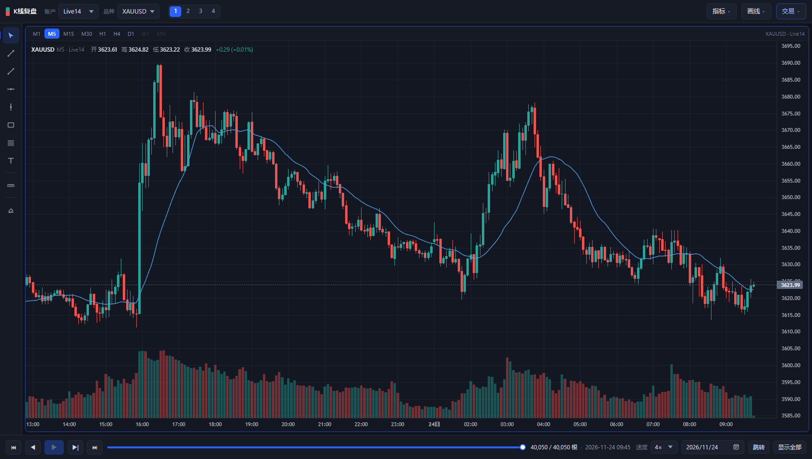
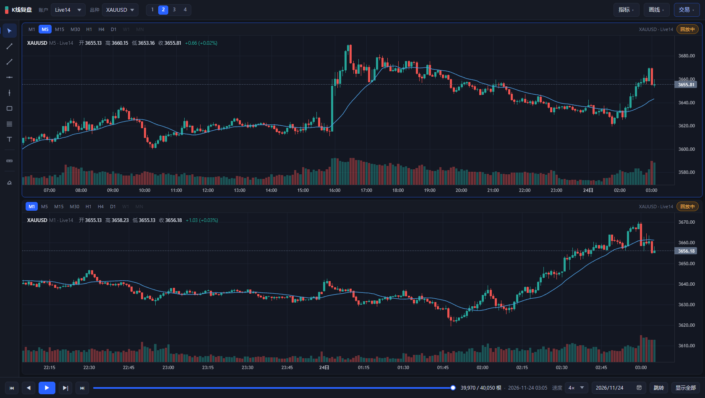

# K线复盘 · 本地 TradingView

直接读取 MT4 的 `.hst` 历史数据，在浏览器里做大屏 K 线复盘：**逐根回放 + 画线分析**。
不需要导入、不需要转换，MT4 里下载了什么这里就有什么。



## 快速开始

双击 **`启动.bat`**。

- 它会转交 `start.ps1`，自动寻找可用的 Python 3（`py -3` → `python` → 常见安装路径）
- 已经有一个实例在跑时不会重复启动，**直接打开浏览器**
- 浏览器打开 <http://127.0.0.1:8766/>；停止服务：`Ctrl+C` 或关掉黑窗口

> 只依赖 Python 3.9+，无需安装任何第三方包；前端图表库已内置在 `web/vendor/`。

命令行等价写法：

```powershell
powershell -ExecutionPolicy Bypass -File start.ps1           # 启动并打开浏览器
powershell -ExecutionPolicy Bypass -File start.ps1 -NoOpen   # 只启动服务
powershell -ExecutionPolicy Bypass -File start.ps1 -Port 9000
```

## 功能

| 模块 | 说明 |
|---|---|
| 数据源 | 直接解析 `C:\Program Files (x86)\MetaTrader 4\history\<服务器>\<品种><周期>.hst`，自动发现所有账户与品种 |
| 周期 | M1 / M5 / M15 / M30 / H1 / H4 / D1 / W1 / MN（本地没有的周期置灰） |
| 多窗格 | 1 / 2 / 3 / 4 个窗格同时看图，每个窗格独立选周期（如 M1 + M5），**时间轴共享、按最小周期推进** |
| 回放 | 播放（1~16 根/秒）、逐根前进后退、进度条拖动、按日期跳转、回到起点/最新 |
| 位置记忆 | 离开时自动记住播放位置，下次打开同一「账户+品种+周期」进度条直接回到原处 |
| 指标 | 主图 MA5/10/20/60、EMA20、布林带(20,2)、成交量；副图 MACD(12,26,9) / RSI(14) |
| 画线 | 趋势线、射线、水平线、垂直线、矩形、斐波那契、文字、测量 |
| 画线编辑 | 选中、拖整条、拖端点、删除、撤销、清空、导出/导入 JSON |
| 复制对象 | **Ctrl + 拖动**画线 → 原地留一份、拖走一份副本（Ctrl+单击不会误建） |
| 持久化 | 画线按「账户+品种+周期」存在浏览器 localStorage，刷新/重启都还在 |
| 模拟交易 | 在回放位置开多/开空、设止损止盈，逐根推进时自动结算；实时浮动盈亏 + 总盈亏/胜率/盈亏比/最大回撤，可导出 CSV |
| 止损拖拽 | 成本线标签左侧 `SL` / `TP` 两个按钮，按住上下拖即可设止损止盈；两条线本身也能拖，约束相对**当前收盘价** |
| 挂单 | 右键菜单下单：市价买卖 + 买入/卖出限价 + 买入/卖出止损，触发自动成交（含跳空价格修正），多张挂单 OCO |

## 多窗格怎么用



顶栏 **1 2 3 4** 切换窗格数量（2/3 是上下叠放，4 是 2×2）。每个窗格有自己的周期按钮行，点 `M1` / `M5` 就换那个窗格的周期。

关键点：**窗格共享同一条时间轴，播放粒度跟最细的周期走**

- 推进 / 播放由**周期最小**的窗格驱动：M5 + M1 时，按一次 `→` 是 **1 根 M1**
- M5 窗格不会跟着跳，它停在当前那根，直到 M1 走完 5 根才进入下一根
- 进度条、日期跳转、`⏮` / `⏭`、显示全部，都作用于这条共享时间轴（底部显示的根数是**最小周期**的）
- 4 个窗格时同理，永远按其中最小的周期推进


每个窗格各自独立维护：画线、模拟交易、指标副图、图例、回放角标。鼠标点哪个窗格，哪个就成为**活动窗格**（边框高亮）——工具栏画笔、右键下单、交易面板都作用于活动窗格。

## 快捷键

| 键 | 作用 |
|---|---|
| `←` / `→` | 上一根 / 下一根 |
| `空格` | 播放 / 暂停 |
| `Home` / `End` | 回到回放起点 / 跳到最新 |
| `V` | 光标（可拖动、可平移图表） |
| `T` / `R` | 趋势线 / 射线 |
| `H` / `L` | 水平线 / 垂直线 |
| `B` / `F` | 矩形 / 斐波那契 |
| `X` / `M` | 文字 / 测量 |
| `Q` / `W` | 开多 / 开空 |
| `E` | 平仓 |
| 右键 | 图表右键菜单（市价 / 挂单 / 平仓） |
| `Del` | 删除选中画线 |
| `Ctrl` + 拖动 | 复制选中的画线 |
| `Ctrl+Z` | 撤销 |
| `Esc` | 取消当前绘制 / 取消选中 / 回到光标 |

## 回放怎么用

1. 打开后默认显示全部数据（右上角无「回放中」角标）。
2. 按 `←` 或点击 **⏮** 退到想看的位置，角标变成「回放中」——此刻之后的 K 线被隐藏。
3. 按 `空格` 开始播放，右侧可调速度；也可以用进度条或「跳转」直接定位到某个日期。
4. 想回到完整视图：点 **⏭** 或「显示全部」。

> 回放起点：默认是「倒数第 500 根」；用「跳转」定位到某个日期后，该日期会成为新的回放起点。

**进度会记住**：把光标停在某根 K 线上离开，下次打开同一品种同一周期，会自动回到那根（右下角提示「已回到上次的播放位置」）。位置按时间戳保存，所以 MT4 补下载了新数据也不会错位；每个「账户+品种+周期」各记各的。

## 画线怎么用

左侧竖条选工具 → 在图上点击放置（两点工具点两次）→ 自动切回光标模式。
光标模式下鼠标移到线上会变手型，可拖动整条线或端点；选中后按 `Del` 删除。

**按住 `Ctrl` 再拖动任意画线 → 复制一份并拖走副本**，原对象留在原地（鼠标变「复制」光标）。Ctrl+单击不会产生副本，只有真正拖动才复制——所以可以放心按住 Ctrl 取。

画线锚点存的是 `{时间, 价格}`，所以缩放、平移、回放都不会跑位。

- 存储位置：浏览器 localStorage，键名 `kline-replay:draw:<账户>:<品种>:<周期>`
- 备份：右上「画线 ▾」→ 导出 JSON；换电脑时用「导入画线 JSON」还原

### 回放中的「未来」画线


回放时游标之后的 K 线是隐藏的，但画线不会因此整条消失：

- **水平线只依赖价格**，与锚点时间无关 → 永远整条显示
- 趋势线 / 矩形 / 斐波那契等，只要有一部分落在已播放区间，就会一直画到可视区右边缘（超出的部分被裁掉）
- 整条都落在游标之后时仍然隐藏——避免提前看到「未来」的图形

> 原因：lightweight-charts 的 `timeToCoordinate` 只认识**当前渲染**的 K 线，未播放的返回 `null`，整条画线就被跳过了。
> 现在改为回退到「完整数据的下标 → `logicalToCoordinate`」外推，坐标算得出来，只是可能落在屏幕外。

## 模拟交易怎么用

点右上 **交易 ▾** 打开面板（也可以直接按快捷键）。

1. 用 `←` 或「跳转」把光标挪到想开仓的那根 K 线，**开仓价 = 当前这根 K 线的收盘价**
2. 填手数 / 合约规模（默认 XAUUSD 100 盎司/手），止损止盈可留空
3. 点 **买入（做多）** 或 **卖出（做空）** / 按 `Q` `W`
4. 用 `→`、进度条或播放推进 K 线——**碰到止损或止盈会自动按该价位平仓**，原因记为「止损/止盈」
5. 也可以随时点 **平仓** / 按 `E` 手动平掉

### 拖拽设止损 / 止盈

成本线右侧标签的**左边有两个按钮：`SL` 和 `TP`**：


- **按住 `SL` 按钮上下拖** → 实时设置止损，红色虚线跟着走，松开生效
- **按住 `TP` 按钮上下拖** → 设置止盈，绿色虚线
- **两条线本身也能拖**：鼠标移上去光标变成上下箭头，拖到哪算哪
- 约束是**相对当前 K 线收盘价**，不是开仓价：
  - 多头：止损 < 现价 < 止盈
  - 空头：止盈 < 现价 < 止损
  - 拖过头会自动夹在现价外侧一个最小变动价位
- 妙处在于**浮盈后可以把止损拖到开仓价之上做跟踪止损**（上图：开仓 4365.99，现价 4387.22，止损已上移到 4377.85）
- 设好后两个价格显示在面板「持仓」区，随持仓一起持久化，刷新还在
- 价格碰到止损/止盈自动平仓，原因记为「止损 / 止盈」

> 按钮在光标模式下才响应（画笔工具激活时优先给画笔）。未设置时按钮灰色，设好后变红/绿。

### 右键下单与挂单

**在图表上右键**同样能下单，价格就是右键落在的那一行：


| 菜单项 | 说明 |
|---|---|
| 市价买入 / 市价卖出 | 按当前这根 K 线的收盘价成交 |
| 买入限价 | 挂在现价**下方**，跌到就买 |
| 卖出限价 | 挂在现价**上方**，涨到就卖 |
| 买入止损 | 挂在现价**上方**，突破就追多 |
| 卖出止损 | 挂在现价**下方**，跌破就追空 |
| 取消挂单 / 取消全部挂单 | 右键落在某条挂单线上时只取消那一条 |

方向不合法的菜单项会置灰（比如把买入限价挂在现价上方），点不动。

挂单会画成虚线并列出在面板「挂单」区，可以点 × 单独撤销。触发规则：

- 限价单：价格回到挂单价时成交；止损单：价格突破挂单价时成交
- **跳空修正**：成交价取 `min/max(挂单价, 该根开盘价)`，不会给你比挂单价更差的价格
- **OCO**：多张挂单里任意一张成交，其余自动撤销
- 开市价单时也会清掉已有挂单（只支持单仓，避免挂单在持仓期间意外成交）

### 结算与统计

面板会显示：当前持仓（方向、手数、开仓价、浮动盈亏）、统计（总盈亏、胜率、盈亏比、均笔、最大回撤、最好/最差）、成交记录列表（点一条可跳回它的开仓位置）。

- 盈亏 = `(平仓价 - 开仓价) × 方向 × 手数 × 合约规模`，XAUUSD 0.1 手每波动 1 美元 = 10 美元
- 同一品种同一时间**只允许一个持仓**，加仓需要先平
- 记录按「账户+品种+周期」独立保存，切周期就是另一本账
- 「导出 CSV」带 BOM，Excel 直接打开不乱码

> 这是**手动模拟盘**，不是自动回测：不会替你决定何时进出，只负责按 K 线逐根结算，适合练盘感和验证画线/结构判断。

## 数据说明

- 读取的是 MT4 **本地已下载**的 K 线，不是实时行情。MT4 里没下过的周期这里也没有。
- 时间戳是**服务器时间**（一般 UTC+2/+3），和 MT4 图表上显示的一致，比北京时间慢 5~6 小时。
- 解析：148 字节文件头 + 60 字节/条记录（`time + 4×double + volume`），兼容旧版 44 字节记录。
  自动去重、纠正 high/low 反写的异常文件。
- MT4 在运行时会锁住 `.hst`，本服务只读打开，不影响 MT4。

### 数据目录优先级

```
1. 环境变量 MT4_HISTORY
2. C:\Program Files (x86)\MetaTrader 4\history   ← 本机装了 MT4 就用这个
3. <仓库>/data/history                            ← 没有 MT4 时用仓库自带的样例数据
```

仓库里 `data/history/` 带了一份 **XAUUSD 等品种的样例数据**（约 28 MB，来自 TradeMaxGlobal
的 Live14 / Demo 账户），所以 clone 下来直接跑就有图可看，不需要先装 MT4。

### 换 MT4 目录

```powershell
$env:MT4_HISTORY = "D:\MT4\history"
python server/app.py --port 8766
```

### 数据更新了但页面没变？

页面加载时会重新解析（服务端按文件 mtime 缓存），刷新浏览器即可。

## 目录结构

```
kline-replay/
├─ 启动.bat                一键启动
├─ start.ps1               启动器（找 Python / 开浏览器）
├─ server/
│  ├─ app.py               HTTP 服务 + JSON API
│  └─ hst.py               .hst 二进制解析
├─ web/
│  ├─ index.html
│  ├─ css/app.css
│  ├─ js/app.js            图表 / 指标 / 回放 / 交易面板
│  ├─ js/drawings.js       画线引擎
│  ├─ js/trading.js        模拟交易引擎（开平仓 / 止损止盈 / 统计）
│  ├─ js/indicators.js     MA/EMA/BOLL/MACD/RSI
│  └─ vendor/              lightweight-charts 5.3（TradingView 官方开源库）
├─ data/history/           样例 K 线数据（MT4 .hst，约 28 MB）
├─ tools/                  Playwright 自动化验证脚本
└─ shots/                  验证截图
```

> `node_modules/` 不入库：前端运行时只用 `web/vendor/` 里的内置库，
> 只有跑 `npm run verify*` 验证脚本时才需要 `npm install`。

## API

| 接口 | 说明 |
|---|---|
| `GET /api/catalog` | 账户 / 品种 / 周期 / 根数 |
| `GET /api/bars?server=&symbol=&period=` | K 线数组 `[时间, 开, 高, 低, 收, 量]` |
| `GET /api/refresh` | 清空解析缓存 |
| `GET /api/health` | 健康检查 |

## 自动化验证

```powershell
npm run verify       # 加载 / 回放 / 画线 / 副图 / 播放，输出 shots/
npm run verify:ux    # 9 项交互断言（平移、拖拽、删除、持久化…）
npm run verify:trade # 15 项交易断言（开仓、浮动盈亏、平仓、止损结算、统计、持久化）
npm run verify:order # 17 项断言（视图变化自动重绘、右键菜单、挂单成交、OCO、取消、持久化）
npm run verify:sl    # 15 项断言（SL/TP 按钮拖拽、跟踪止损、按现价夹紧、持久化）
npm run verify:copy  # 13 项断言（Ctrl 复制、播放位置记忆、按周期隔离）
npm run verify:layout # 16 项断言（1/2/3/4 窗格、独立周期、跨窗格时间轴同步）
npm run verify:future # 8 项断言（回放到锚点之前画线不消失、像素级确认已绘制）
```

使用系统已安装的 Edge/Chrome（`CHANNEL=msedge` 可改），不额外下载浏览器。

## 故障排查

### 双击 `启动.bat` 后弹出「你要用什么应用打开 .py 文件」

这是启动器没能找到能用的 Python，Windows 于是把 `.py` 当普通文件去问你要用哪个程序打开。
两个常见原因，现在都已规避：

1. `python` 命令指向了 **Microsoft Store 的占位程序**
   （`%LOCALAPPDATA%\Microsoft\WindowsApps\python.exe`，0 字节，跑不了任何脚本）。
   新版启动器会**主动跳过** `WindowsApps` 里的 python，并且真跑一次
   `python -c "import sys"` 验证，只认真正能执行的解释器。
2. 旧版 `.bat` 是 LF 换行 + UTF-8 中文，cmd.exe 解析不可靠。
   现在 `.bat` 只做一件事：转交 PowerShell（纯 ASCII、CRLF 换行）。

如果仍然报错，启动器会列出它排除了哪些路径，把那段提示发我即可。

### 想指定 Python

在 `start.ps1` 的 `$common` 数组里加上你的路径，或者直接命令行：

```powershell
& "D:\Conda\python.exe" server\app.py --port 8766 --open
```

### 端口被占用

启动器会先探测 8766，已经在跑就直接打开浏览器；真要换端口用 `-Port 9000`。

### 黑窗口一闪就没了

用命令行跑一遍 `powershell -ExecutionPolicy Bypass -File start.ps1`，就能看到完整报错。

## 已知限制

- 图表时间轴按 UTC 显示（即 MT4 服务器时间），不随系统时区偏移。
- 画线只在同一「品种+周期」内可见，切换周期不通用。
- 模拟交易同一品种同一时间只允许一个持仓，不支持分批加仓/对冲锁仓。
- 成交价用的是止损/止盈价本身，没有模拟点差和滑点。
- 只支持桌面浏览器；小屏会挤，但可用。
