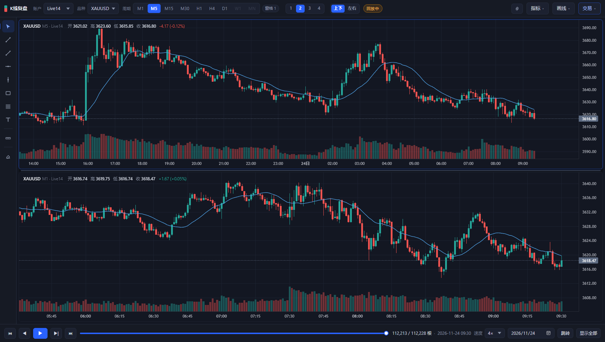
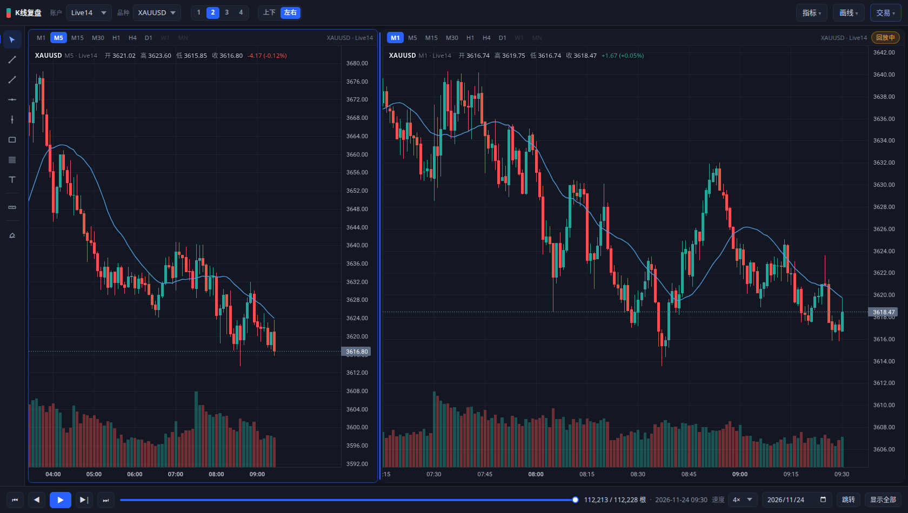
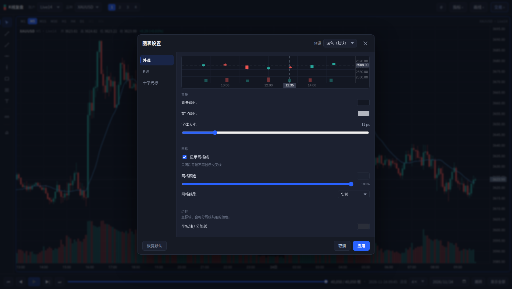
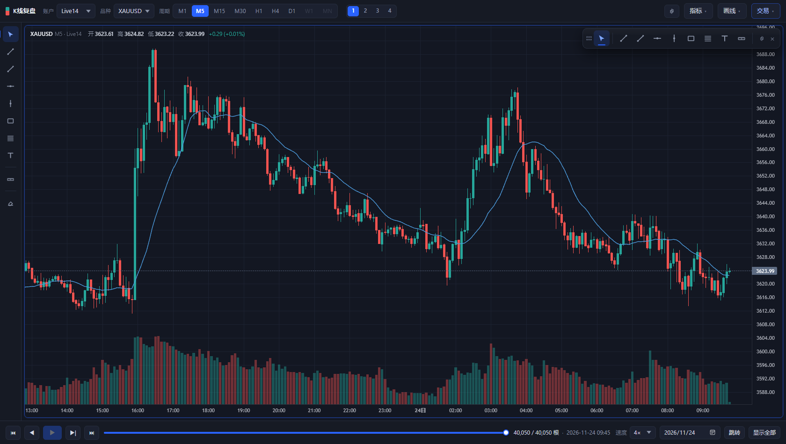
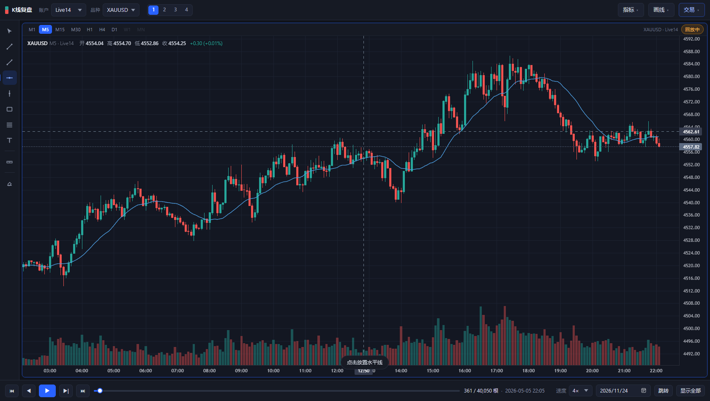
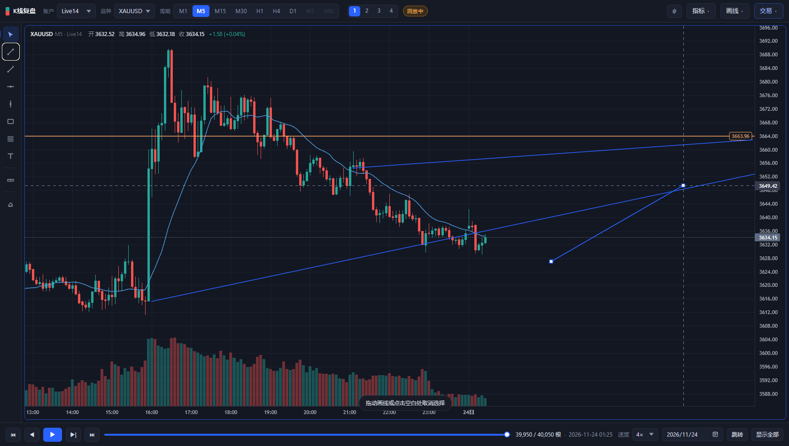
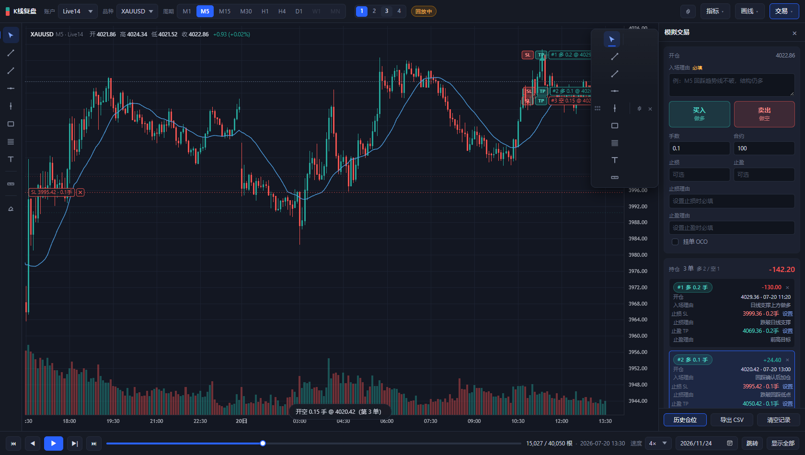
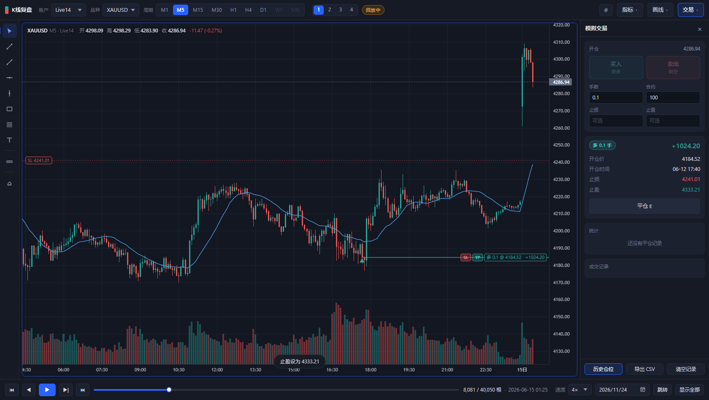
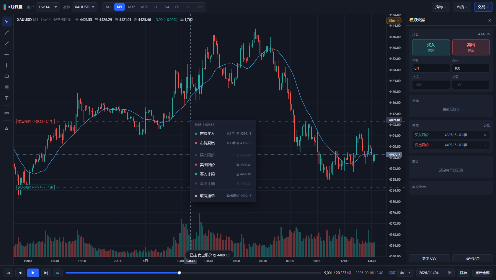

# K线复盘 · 本地 TradingView

直接读取 MT4 的 `.hst` 历史数据，在浏览器里做大屏 K 线复盘：**逐根回放 + 画线分析**。
不需要导入、不需要转换，MT4 里下载了什么这里就有什么。


## 快速开始

**Windows**：双击 **`scripts\启动.bat`**（或在仓库根目录执行 `npm start`）。

- 它会转交 `scripts/start.ps1`，自动寻找可用的 Python 3（`py -3` → `python` → 常见安装路径）
- 已经有一个实例在跑时不会重复启动，**直接打开浏览器**
- 浏览器打开 <http://127.0.0.1:8766/>；停止服务：`Ctrl+C` 或关掉黑窗口

Windows 命令行等价写法：

```powershell
powershell -ExecutionPolicy Bypass -File scripts\start.ps1           # 启动并打开浏览器
powershell -ExecutionPolicy Bypass -File scripts\start.ps1 -NoOpen   # 只启动服务
powershell -ExecutionPolicy Bypass -File scripts\start.ps1 -Port 9000
```

**Linux**：在仓库根目录执行：

```bash
./scripts/start.sh              # 启动并打开浏览器
./scripts/start.sh --no-open    # 只启动服务
./scripts/start.sh --port 9000  # 换端口
```

- 按 `PYTHON_BIN` → `python3` → `python` → 常见安装路径的顺序寻找 Python 3.9+
- 已经有一个实例在跑时直接打开浏览器；端口被别的程序占用会报错，不会静默换端口
- 首次使用如果提示没有执行权限：`chmod +x scripts/start.sh`

> 只依赖 Python 3.9+，无需安装任何第三方包；前端图表库已内置在 `web/vendor/`。

## 功能

| 模块 | 说明 |
|---|---|
| 数据源 | 直接解析 `C:\Program Files (x86)\MetaTrader 4\history\<服务器>\<品种><周期>.hst`，自动发现所有账户与品种 |
| 周期 | M1 / M5 / M15 / M30 / H1 / H4 / D1 / W1 / MN（本地没有的周期置灰） |
| 多窗格 | 1 / 2 / 3 / 4 个窗格同时看图，每个窗格独立选周期（如 M1 + M5），**时间轴共享、按最小周期推进**；双窗格支持上下/左右分屏，拖动中间分隔线调整两边大小 |
| 回放 | 播放（1~16 根/秒）、逐根前进后退、进度条拖动、按日期跳转、回到起点/最新 |
| 位置记忆 | 离开时自动记住播放位置，下次打开同一「账户+品种+周期」进度条直接回到原处 |
| 指标 | 主图 MA5/10/20/60、EMA20、布林带(20,2)、成交量（可开关）；副图 MACD(12,26,9) / RSI(14) |
| 图表外观 | TradingView 风格设置：背景色、网格显隐/颜色/透明度/线型、K线实体/边框/影线颜色与透明度、十字光标、成交量透明度、最新价线；内置深色 / 浅色 / 午夜蓝预设，所有窗格共用并本地持久化 |
| 画线 | 趋势线、射线、水平线、垂直线、矩形、斐波那契、文字、测量；回放中起点/终点可落在游标之后的空白未来区 |
| 画线编辑 | 选中、拖整条、拖端点、删除、撤销、清空、导出/导入 JSON |
| 画线样式 | 双击画线打开样式面板：线条/文字颜色、整体透明度；矩形可单独设边框色、填充色、填充透明度；斐波那契可增删水平位、改比例（支持 -0.5、1.618 等任意值）和逐条配色；可存为同类新画线的默认样式 |
| 悬浮画线栏 | 图表上可自由拖动的绘图工具栏；在设置里勾选要显示的工具，**只显示勾选项**；位置、工具选择和显隐自动记住 |
| 精确定位 | 画线落点 / 拖端点时按住 **Shift** 横向锁定（拖整条线同样生效）；按住 **Ctrl** 吸附到鼠标所在 K 线最近的 开/高/低/收；回放时只吸附已播放 K 线 |
| 复制对象 | **Ctrl + 拖动线体** → 原地留一份、拖走一份副本（拖两点工具端点是吸附；单点工具仍复制；Ctrl+单击不会误建） |
| 持久化 | 画线按「账户+品种+周期」存在浏览器 localStorage，刷新/重启都还在 |
| 模拟交易 | 在回放位置开多/开空、设止损止盈，**可同时持有多笔**（加仓 / 多空对冲），逐根推进时逐单结算；实时浮动盈亏 + 总盈亏/胜率/盈亏比/最大回撤，可导出 CSV；历史仓位可在图上显示/隐藏 |
| 止损拖拽 | 每条成本线标签左侧的 `SL` / `TP` 两个按钮，按住上下拖即可给该笔持仓设止损止盈；两条线本身也能拖，约束相对**当前收盘价** |
| 挂单 | 右键菜单下单：市价买卖 + 买入/卖出限价 + 买入/卖出止损，触发自动成交（含跳空价格修正）；挂单可与持仓并存，可开 OCO |

## 多窗格怎么用


顶栏 **1 2 3 4** 切换窗格数量（3 是上下叠放，4 是 2×2）。周期按钮 `M1 / M5 / M15…` 统一放在顶栏、和账户/品种同一行，作用于**当前活动窗格**（边框高亮）；多窗格时旁边会显示「窗格 N」，点一下目标图表再点周期即可单独切换该窗格。

双窗格可在顶栏 **上下 / 左右** 之间切换分屏方向；拖动两个窗格中间的分隔线即可自由调整大小（往左拖压缩左图、放大右图），双击分隔线恢复 50/50，分隔线聚焦后也可用方向键微调。

关键点：**窗格共享同一条时间轴，播放粒度跟最细的周期走**

- 推进 / 播放由**周期最小**的窗格驱动：M5 + M1 时，按一次 `→` 是 **1 根 M1**
- M5 窗格不会跟着跳，它停在当前那根，直到 M1 走完 5 根才进入下一根
- 高周期 K 线只在覆盖的低周期 K 线全部走完后出现：M1 到 `12:04`（第 5 根）时 M5 的 `12:00` 那根才画出来，`12:00 ~ 12:03` 期间 M5 仍停在 `11:55`，不会提前暴露未来数据
- 进度条、日期跳转、`⏮` / `⏭`、显示全部，都作用于这条共享时间轴（底部显示的根数是**最小周期**的）
- 4 个窗格时同理，永远按其中最小的周期推进





每个窗格各自独立维护：画线、模拟交易、指标副图、图例。鼠标点哪个窗格，哪个就成为**活动窗格**（边框高亮）——工具栏画笔、右键下单、顶栏周期按钮、交易面板都作用于活动窗格。「回放中」角标统一显示在顶栏（各窗格共享同一条时间轴）。

## 图表外观怎么调

点顶栏右上角的 **⚙**，或在图表上**右键 → 图表设置…**。



弹窗左边分三类，右上角可一键切换预设（深色 / 浅色 / 午夜蓝），中间是实时预览：

- **外观**：背景颜色、文字颜色、字体大小；网格线开关（关闭后背景不再有交叉线）、网格颜色 / 不透明度 / 线型；坐标轴与窗格分隔线颜色
- **K线**：上涨 / 下跌**实体**颜色 + 不透明度；**边框**颜色 + 不透明度（可勾选“跟随涨跌颜色”）；**影线**颜色 + 不透明度（同样可跟随）；成交量不透明度；最新价线开关 / 颜色
- **十字光标**：显示开关、线条颜色 + 不透明度、线型、价格/时间标签背景色

改动会立刻预览到背后的图表（大历史数据的成交量柱在停止拖动后刷新），点 **应用** 才保存；点 **取消**、`Esc` 或右上角 `×` 会回滚。样式对**所有窗格**生效，存在浏览器 localStorage 里，刷新后依旧保持。

> 边框和影线的“跟随涨跌颜色”开启时取实体的色相，但它们的不透明度是单独生效的；关闭后可以各自选颜色。

> 历史数据很大（单窗格超过 15 万根）时，成交量柱不会跟着拖动实时重建，而是在停止拖动约半秒后刷新一次，避免连续卡顿；点「应用」时再统一校准。

## 快捷键

| 键 | 作用 |
|---|---|
| `←` / `→` | 上一根 / 下一根 |
| `空格` | 播放 / 暂停 |
| `Home` / `End` | 回到回放起点 / 跳到最新 |
| `V` | 光标（可拖动、可平移图表） |
| `T` / `R` | 趋势线 / 射线 |
| `H` / `L` | 水平线 / 垂直线 |
| `B` / `F` | 矩形 / 斐波那契 |
| `X` / `M` | 文字 / 测量 |
| `Q` / `W` | 开多 / 开空 |
| `E` | 平掉当前选中的持仓 |
| 右键 | 图表右键菜单（画线样式 / 市价 / 挂单 / 平仓） |
| 双击画线 | 打开该条画线的样式面板 |
| `Del` | 删除选中画线 |
| `Shift` + 移动 | 横向锁定：画线落点/拖端点时价格不动；拖整条线 = 水平平移 |
| `Ctrl` + 移动 | 画线落点 / 拖端点吸附到鼠标所在 K 线最近的 `O/H/L/C` |
| `Ctrl` + 拖动 | 光标模式下拖线体/单点工具复制；拖两点工具端点是吸附 |
| `Ctrl+Z` | 撤销 |
| `Esc` | 取消当前绘制 / 取消选中 / 回到光标 |

> macOS 上用 `⌘`（Command）代替 `Ctrl`，代码同时识别 `ctrlKey` 与 `metaKey`。

## 回放怎么用

1. 打开后默认显示全部数据（右上角无「回放中」角标）。
2. 按 `←` 或点击 **⏮** 退到想看的位置，角标变成「回放中」——此刻之后的 K 线被隐藏。
3. 按 `空格` 开始播放，右侧可调速度；也可以用进度条或「跳转」直接定位到某个日期。
4. 想回到完整视图：点 **⏭** 或「显示全部」。

> 回放起点：默认是「倒数第 500 根」；用「跳转」定位到某个日期后，该日期会成为新的回放起点。

**进度会记住**：把光标停在某根 K 线上离开，下次打开同一品种同一周期，会自动回到那根（右下角提示「已回到上次的播放位置」）。位置按时间戳保存，所以 MT4 补下载了新数据也不会错位；每个「账户+品种+周期」各记各的。

## 画线怎么用

左侧竖条选工具 → 在图上点击放置（两点工具点两次）→ 自动切回光标模式。
光标模式下鼠标移到线上会变手型，可拖动整条线或端点；选中后按 `Del` 删除。

**按住 `Ctrl` 拖动线体 → 复制一份并拖走副本**，原对象留在原地（鼠标变「复制」光标）。Ctrl+单击不会产生副本，只有真正拖动才复制——所以可以放心按住 Ctrl 取。

拖动**两点工具（趋势线/射线/矩形/斐波那契）的端点**时 `Ctrl` 不再复制，而是和画线落点一样吸附到最近的开/高/低/收；拖动过程中会显示黄圈与价位标签。

**精确定位（画线 / 拖端点）**：

- 两点工具落下第一点后，按住 `Shift` 移动鼠标：价格锁在第一点，只横向移动；拖端点同样锁原价，拖整条线则整条水平平移（`Shift` 与 `Ctrl` 同时按住时，横向锁定优先）。
- 按住 `Ctrl` 移动鼠标：取鼠标所在 K 线（横坐标最近的一根）的 `open / high / low / close`，按指针与四个价位的屏幕距离选最近的一个吸附。预览里会画一个黄圈并标出 `H 3638.18` 这样的目标价位，松手前就能确认。
- 光标模式下拖**线体**时 `Ctrl` 仍用于复制；拖**两点工具的端点**则按上面的规则吸附。单点工具（水平线/垂直线/文字）没有独立端点，`Ctrl` 拖动仍复制；放置时它们同样支持 `Ctrl` 吸附。
- 回放状态下 `Ctrl` 吸附只在已播放的 K 线里查找。鼠标移到游标右侧时落点不再贴回游标，而是落在对应的未来 K 线时间上；按住 `Ctrl` 也不会吸附未来 K 线的 OHLC，不会提前暴露未来价格。

**回放中画到未来**：游标右侧的空白区也可以落点（最多到本地数据最后一根）。用光标模式把图表向左拖，就能露出更多未来空白，再把趋势线 / 矩形 / 斐波那契的终点放进去。

画线锚点存的是 `{时间, 价格}`，所以缩放、平移、回放都不会跑位。

- 存储位置：浏览器 localStorage，键名 `kline-replay:draw:<账户>:<品种>:<周期>`
- 备份：右上「画线 ▾」→ 导出 JSON；换电脑时用「导入画线 JSON」还原

### 悬浮绘图工具栏



左侧竖条之外，图表右上角还有一条**可自由拖动的横向画线工具栏**，不额外占用图表布局空间，常用工具可以放在手边：

- 按住左侧把手（或工具栏空白处）拖到任意位置；位置按相对比例保存，缩放窗口、切换 1/2/3/4 窗格后仍然贴在原来的相对位置，并且始终被夹在图表区域内。
- 点 **⚙** 打开「悬浮工具栏设置」，勾选要显示的工具。**未勾选的工具不会渲染**，只有侧边栏里还保留入口；工具顺序与侧边栏一致。
- 设置面板支持「全选 / 清空」；勾选结果立即生效，并写入 localStorage 的 `kline-replay:float-tools`。
- 点 **×** 隐藏；之后可在右上「画线 ▾ → 显示悬浮工具栏」找回，或从「画线 ▾ → 选择显示的工具…」直接打开设置。
- 工具栏作用于**当前活动窗格**，按钮高亮与侧边栏、快捷键、Esc 回光标保持同步；画完一条线自动回到光标模式。
- 工具选择、位置和显隐都会跨刷新保留。

### 自定义画线样式

双击任意画线即可打开样式面板；也可以先选中画线，再走右上「画线 ▾ → 画线样式…」，或在画线上点右键选「画线样式…」。

- **线条 / 文字**：改线条颜色（文字改文字颜色）和整体透明度。
- **矩形**：边框颜色、填充颜色、整体透明度、填充透明度分开设置。
- **斐波那契**：每条水平位单独一行，可勾选显示/隐藏、改比例、改颜色；点「+ 添加水平位」会先补一个 `-0.5`，比例框可填任意数值（如 `0.5`、`-0.5`、`1.618`），负数水平位会画在起终点外侧。
- 面板底部的「存为‘xxx’新画线默认」会把当前样式保存为同类工具的新画线默认值，键名 `kline-replay:draw-defaults`；之后新建同类画线直接沿用，不影响已有画线。

样式随画线一起存进 localStorage 和导出的 JSON，刷新、换周期再回来都还在。

### 回放中的「未来」画线



回放时游标之后的 K 线不渲染，但画线锚点可以落在游标右侧的空白未来区：

- 两点工具的起点和终点都能点在未来空白区，趋势线 / 矩形 / 斐波那契会直接画在空白区，直到播放推进到那些 K 线
- 只要落在可视区内就正常绘制，超出可视区的部分只是被画布裁剪（不是代码把整条未来画线隐藏）
- **水平线只依赖价格**，与锚点时间无关 → 永远整条显示
- 未来锚点只存 `{时间, 价格}`，不读取未来 K 线的 OHLC；`Ctrl` 吸附仍只在已播放 K 线里查找
- 想看更远的未来：先用光标模式把图表向左拖（或用滚轮缩小图表），再选画线工具；最多只能到本地数据最后一根



> 坐标原理：lightweight-charts 的 `timeToCoordinate` 只认识**当前渲染**的 K 线，未播放的返回 `null`；画线层用完整数据的下标走 `logicalToCoordinate` 算出坐标。未来锚点会随播放推进自然变成普通锚点，不会跳位。

## 模拟交易怎么用

点右上 **交易 ▾** 打开面板（也可以直接按快捷键）。

1. 用 `←` 或「跳转」把光标挪到想开仓的那根 K 线，**开仓价 = 当前这根 K 线的收盘价**
2. 填手数 / 合约规模（默认 XAUUSD 100 盎司/手），止损止盈可留空
3. 点 **买入（做多）** 或 **卖出（做空）** / 按 `Q` `W`
4. 用 `→`、进度条或播放推进 K 线——**碰到止损或止盈会自动按该价位平仓**，原因记为「止损/止盈」
5. 也可以随时点 **平仓** / 按 `E` 手动平掉

### 多笔持仓（加仓 / 对冲）

买入 / 卖出可以连续点：已有持仓时再点一次就是**新开一笔**，不会覆盖或平掉前面的持仓。同向连续开仓就是加仓，反向开仓就是多空对冲。



- 面板「持仓」区按笔列出：编号、方向、手数、开仓价/时间、每笔浮动盈亏；标题右侧是**所有持仓的合计浮盈**
- 点某一笔把它设为**当前持仓**（图上成本线和标签加亮）；`平仓` 按钮 / `E` 只平当前这一笔，行内 `×` 直接平掉对应的一笔，多笔时还有 **全部平仓**
- 每笔持仓**独立止损止盈**：每条成本线都有自己的 `SL` / `TP` 按钮，拖哪个改哪个；未选中的持仓只画淡色止损/止盈线，避免满屏标签
- 同一价位加仓时，图上标签会按 20px 自动向下错开，不会叠成一团
- 挂单自动成交不会抢走当前选中的持仓，新成交的单只出现在列表里（成交提示会带 `#编号`）
- 持仓按「账户+品种+周期」分别持久化，刷新后多笔持仓和当前选中项都还在

### 拖拽设止损 / 止盈

成本线右侧标签的**左边有两个按钮：`SL` 和 `TP`**（每笔持仓各有一对）：



- **按住 `SL` 按钮上下拖** → 实时设置止损，红色虚线跟着走，松开生效
- **按住 `TP` 按钮上下拖** → 设置止盈，绿色虚线
- **两条线本身也能拖**：鼠标移上去光标变成上下箭头，拖到哪算哪
- 约束是**相对当前 K 线收盘价**，不是开仓价：
  - 多头：止损 < 现价 < 止盈
  - 空头：止盈 < 现价 < 止损
  - 拖过头会自动夹在现价外侧一个最小变动价位
- 妙处在于**浮盈后可以把止损拖到开仓价之上做跟踪止损**（上图：开仓 4184.52，现价 4286.94，止损已上移到 4241.01）
- 设好后两个价格显示在对应那一笔的「持仓」行，随持仓一起持久化，刷新还在
- 价格碰到止损/止盈自动平仓，原因记为「止损 / 止盈」

> 按钮在光标模式下才响应（画笔工具激活时优先给画笔）。未设置时按钮灰色，设好后变红/绿。

### 右键下单与挂单

**在图表上右键**同样能下单，价格就是右键落在的那一行：



| 菜单项 | 说明 |
|---|---|
| 市价买入 / 市价卖出 | 按当前这根 K 线的收盘价成交 |
| 买入限价 | 挂在现价**下方**，跌到就买 |
| 卖出限价 | 挂在现价**上方**，涨到就卖 |
| 买入止损 | 挂在现价**上方**，突破就追多 |
| 卖出止损 | 挂在现价**下方**，跌破就追空 |
| 取消挂单 / 取消全部挂单 | 右键落在某条挂单线上时只取消那一条 |
| 平仓 / 全部平仓 | 有持仓时出现：平仓只平当前选中那一笔，全部平仓一次清空 |

方向不合法的菜单项会置灰（比如把买入限价挂在现价上方），点不动。

挂单会画成虚线并列出在面板「挂单」区，可以点 × 单独撤销。触发规则：

- 限价单：价格回到挂单价时成交；止损单：价格突破挂单价时成交
- **跳空修正**：成交价取 `min/max(挂单价, 该根开盘价)`，不会给你比挂单价更差的价格
- **挂单独立触发**：一张成交不影响其他挂单，也不会顶掉已有持仓
- **OCO（可选）**：在交易面板勾选「挂单 OCO」后，任意一张挂单成交会撤销其余挂单；切换立即作用于已挂出的单并随挂单一起持久化，升级前已有的挂单会按旧版隐式 OCO 迁移（不改变当前开关状态，手动切换 OCO 后所有品种/周期统一按开关执行）
- 开市价单不会清掉挂单，挂单和持仓可以同时存在

### 结算与统计

面板会显示：当前持仓列表（每笔的方向、手数、开仓价、浮盈亏，以及合计浮盈）、统计（总盈亏、胜率、盈亏比、均笔、最大回撤、最好/最差）、成交记录列表（点一条可跳回它的开仓位置）。

- 盈亏 = `(平仓价 - 开仓价) × 方向 × 手数 × 合约规模`，XAUUSD 0.1 手每波动 1 美元 = 10 美元
- 同一品种同一时间可以持有多笔（同向加仓、反向对冲都行），每笔按自己的开仓价 / 手数单独结算；统计只算已平仓记录
- 记录按「账户+品种+周期」独立保存，切周期就是另一本账
- 图表上的历史仓位（虚线 + 收益标签）完全由成交记录绘制：**清空记录后图上同步消失**，不会残留
- 交易面板底部 **历史仓位** 按钮可随时显示/隐藏图上历史仓位，开关状态跨刷新记住；当前持仓不受影响
- 「导出 CSV」带 BOM，Excel 直接打开不乱码

> 这是**手动模拟盘**，不是自动回测：不会替你决定何时进出，只负责按 K 线逐根结算，适合练盘感和验证画线/结构判断。

## 数据说明

- 读取的是 MT4 **本地已下载**的 K 线，不是实时行情。MT4 里没下过的周期这里也没有。
- 时间戳是**服务器时间**（一般 UTC+2/+3），和 MT4 图表上显示的一致，比北京时间慢 5~6 小时。
- 解析：148 字节文件头 + 60 字节/条记录（`time + 4×double + volume`），兼容旧版 44 字节记录。
  自动去重、纠正 high/low 反写的异常文件。
- MT4 在运行时会锁住 `.hst`，本服务只读打开，不影响 MT4。

### 数据目录优先级

```
1. 环境变量 MT4_HISTORY
2. C:\Program Files (x86)\MetaTrader 4\history   ← Windows 装了 MT4 就用这个
3. <仓库>/data/history                            ← 没有 MT4 时用仓库自带的样例数据
```

Linux 上没有默认的 Windows 路径，一般直接使用仓库自带的样例数据；
如果 MT4 跑在 Wine 里，把 `MT4_HISTORY` 指过去即可：

```bash
export MT4_HISTORY="$HOME/.wine/drive_c/Program Files (x86)/MetaTrader 4/history"
./scripts/start.sh
```

仓库里 `data/history/` 带了一份 **XAUUSD 等品种的样例数据**（约 28 MB，来自 TradeMaxGlobal
的 Live14 / Demo 账户），所以 clone 下来直接跑就有图可看，不需要先装 MT4。

### 换 MT4 目录

```powershell
$env:MT4_HISTORY = "D:\MT4\history"
python server/app.py --port 8766
```

### 数据更新了但页面没变？

页面加载时会重新解析（服务端按文件 mtime 缓存），刷新浏览器即可。

## 目录结构

```
kline-replay/
├─ scripts/
│  ├─ 启动.bat             Windows 一键启动
│  ├─ start.ps1            Windows 启动器（找 Python / 开浏览器）
│  └─ start.sh             Linux 启动器
├─ server/
│  ├─ app.py               HTTP 服务 + JSON API
│  └─ hst.py               .hst 二进制解析
├─ web/
│  ├─ index.html
│  ├─ css/app.css
│  ├─ js/app.js            图表 / 指标 / 回放 / 交易面板
│  ├─ js/drawings.js       画线引擎
│  ├─ js/float-tools.js    悬浮画线工具栏（拖动 / 工具选择 / 持久化）
│  ├─ js/trading.js        模拟交易引擎（开平仓 / 止损止盈 / 统计）
│  ├─ js/indicators.js     MA/EMA/BOLL/MACD/RSI
│  ├─ js/chart-style.js    图表外观设置（背景/网格/K线/十字光标、预设与持久化）
│  └─ vendor/              lightweight-charts 5.3（TradingView 官方开源库）
├─ data/history/           样例 K 线数据（MT4 .hst，约 28 MB）
├─ tools/                  Playwright 自动化验证脚本
└─ shots/                  验证截图
```

> `node_modules/` 不入库：前端运行时只用 `web/vendor/` 里的内置库，
> 只有跑 `npm run verify*` 验证脚本时才需要 `npm install`。

## API

| 接口 | 说明 |
|---|---|
| `GET /api/catalog` | 账户 / 品种 / 周期 / 根数 |
| `GET /api/bars?server=&symbol=&period=` | K 线数组 `[时间, 开, 高, 低, 收, 量]` |
| `GET /api/refresh` | 清空解析缓存 |
| `GET /api/health` | 健康检查 |

## 自动化验证

```powershell
npm run verify       # 加载 / 回放 / 画线 / 副图 / 播放，输出 shots/
npm run verify:ux    # 15 项交互断言（平移、拖拽、删除、持久化、成交量开关…）
npm run verify:trade # 23 项交易断言（开仓、浮动盈亏、平仓、止损结算、统计、持久化、历史仓位开关、清空即落盘）
npm run verify:order # 18 项断言（视图变化自动重绘、右键菜单、挂单成交、挂单与持仓并存、取消、持久化）
npm run verify:sl    # 15 项断言（SL/TP 按钮拖拽、跟踪止损、按现价夹紧、持久化）
npm run verify:multi # 71 项断言（多笔同时持仓、多空对冲、逐单平仓、全部平仓、每单独立止损、挂单与持仓并存、独立成交 / OCO 开关与旧挂单迁移、OCO 刷新持久化、持仓编号持久化、挂单成交不抢选中、拖拽安全、全部平仓单次刷新、多窗格隔离）
npm run verify:float # 43 项断言（默认工具、勾选后只显示勾选项、拖动与边界夹取、位置/选择/显隐持久化、存储失败提示、菜单入口、窄屏换行、多窗格活动窗格、悬浮工具画线）
npm run verify:copy  # 13 项断言（Ctrl 复制、播放位置记忆、按周期隔离）
npm run verify:layout # 51 项断言（1/2/3/4 窗格、上下/左右分屏、拖动分隔线、独立周期、跨窗格时间轴同步、顶栏周期条与窄屏可用性、换品种后周期置灰刷新）
npm run verify:future # 15 项断言（回放到锚点之前画线不消失、未来空白区可落点、纯未来画线可见、像素级确认已绘制）
npm run verify:snap  # 33 项断言（Shift/Ctrl/⌘ 定位、端点吸附、单点复制、回放边界、窗格销毁释放）
npm run verify:style # 24 项断言（样式入口、矩形配色/旧矩形同步、低透明度显示、fib 自定义与非法值、旧数据兼容、撤销同步/空栈、measure 无入口、存储失败提示、持久化）
npm run verify:chart-style # 37 项断言（默认外观、网格开关/颜色/线型、背景与取消回滚、K线实体/边框/影线透明度、成交量、十字光标、预设、恢复默认、刷新持久化、多窗格继承、右键入口、Esc 回滚、只改背景不重建成交量、播放中应用设置、播放中改回原色、默认图例配色、真实画布重绘、浅色 SL/TP、脏数据清洗）
```

使用系统已安装的 Edge/Chrome（`CHANNEL=msedge` 可改），不额外下载浏览器。

## 故障排查

### 双击 `scripts\启动.bat` 后弹出「你要用什么应用打开 .py 文件」

这是启动器没能找到能用的 Python，Windows 于是把 `.py` 当普通文件去问你要用哪个程序打开。
两个常见原因，现在都已规避：

1. `python` 命令指向了 **Microsoft Store 的占位程序**
   （`%LOCALAPPDATA%\Microsoft\WindowsApps\python.exe`，0 字节，跑不了任何脚本）。
   新版启动器会**主动跳过** `WindowsApps` 里的 python，并且真跑一次
   `python -c "import sys"` 验证，只认真正能执行的解释器。
2. 旧版 `.bat` 是 LF 换行 + UTF-8 中文，cmd.exe 解析不可靠。
   现在 `.bat` 只做一件事：转交 PowerShell（纯 ASCII、CRLF 换行）。

如果仍然报错，启动器会列出它排除了哪些路径，把那段提示发我即可。

### 想指定 Python

在 `scripts/start.ps1` 的 `$common` 数组里加上你的路径，或者直接命令行：

```powershell
& "D:\Conda\python.exe" server\app.py --port 8766 --open
```

Linux 用 `PYTHON_BIN` 指定：

```bash
PYTHON_BIN=/usr/bin/python3.12 ./scripts/start.sh
```

### 端口被占用

启动器会先探测 8766，已经在跑就直接打开浏览器；真要换端口用 `-Port 9000`（Windows）
或 `--port 9000`（Linux）。Linux 下如果 8766 被其他程序占用，`start.sh`
会直接报错而不是静默换端口，避免提示的地址和实际监听端口不一致。

### 黑窗口一闪就没了

用命令行跑一遍 `powershell -ExecutionPolicy Bypass -File scripts\start.ps1`，就能看到完整报错。

### Linux 提示找不到 Python 3

安装 Python 3.9+（Debian/Ubuntu: `sudo apt install python3`），或者用
`PYTHON_BIN=/path/to/python3 ./scripts/start.sh` 指定解释器。启动器会列出它排除了哪些路径。

## 已知限制

- 图表时间轴按 UTC 显示（即 MT4 服务器时间），不随系统时区偏移。
- 画线只在同一「品种+周期」内可见，切换周期不通用。
- 回放中的未来锚点最多落在本地数据的最后一根 K 线；点击超出数据末尾的空白会贴到最后一根。右侧未来空白能露出多少取决于当前视口，需要时先平移/缩放。
- 模拟交易支持多笔同时持仓，但每笔独立结算、不做净头寸合并；同向加仓与反向对冲都按各自成本计算浮动盈亏。
- 挂单 OCO 是可选开关（面板「挂单 OCO」），默认关闭，以保证多张挂单可以各自成交。
- 成交价用的是止损/止盈价本身，没有模拟点差和滑点。
- 只支持桌面浏览器；小屏会挤，但可用。
